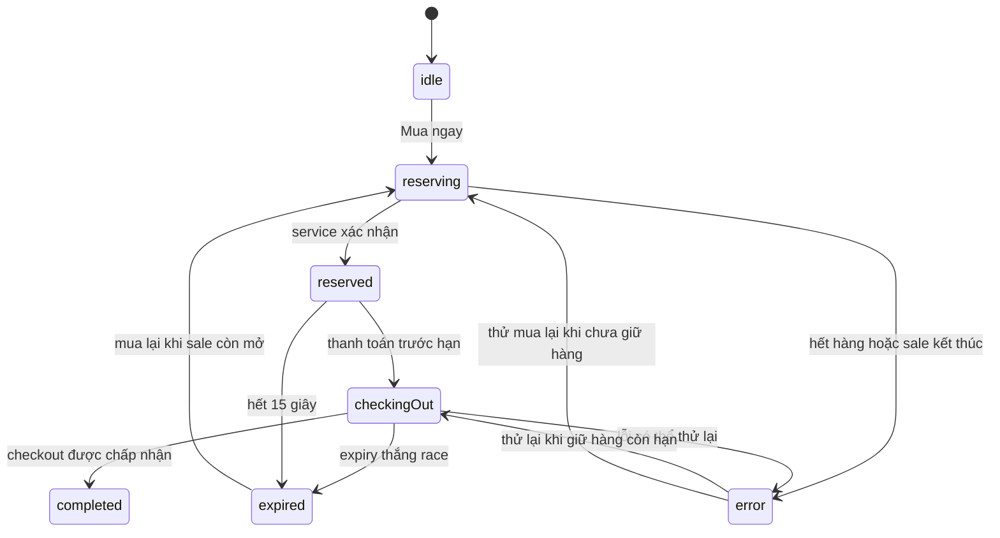

# MSIS207.R11.CTTT — HW3 Mega-Sale

Mô phỏng flash sale một sản phẩm tại Việt Nam bằng React, TypeScript strict, Vite và CSS thuần.

## Chạy ứng dụng

Yêu cầu Node.js 20.19+.

```bash
npm ci
npm run dev
```

Các lệnh kiểm chứng:

```bash
npm run typecheck
npm test
npm run lint
npm run build
```

## Mô hình trạng thái



## Quy tắc thời gian và tồn kho

Thông số demo nằm ở [`src/domain/saleConfig.ts`](src/domain/saleConfig.ts): một tai nghe giá 1.290.000 ₫, tồn kho 5, phiên sale 120 giây, giữ một đơn vị mỗi lần trong 15 giây.

Countdown giữ deadline tuyệt đối và mỗi frame tính `Math.max(0, targetTime - Date.now())`; không tích lũy bằng `setInterval`. Khi tab hiển thị lại, timer tính lại từ deadline. Service kiểm tra deadline sale và reservation ngay tại thao tác, nên giá trị hiển thị không quyết định quyền mua hay checkout. Hàng đã được giữ vẫn checkout được sau khi sale đóng, cho đến hạn riêng của reservation.

`InMemoryInventoryService` là nguồn sự thật duy nhất trong phiên mô phỏng. Mỗi lần cập nhật phải giữ bất biến `available + reserved + sold = initialStock`; cả ba số không âm. Reservation và checkout có ID ổn định, kiểm soát phản hồi cũ bằng ID/version, hết hạn trả hàng đúng một lần và checkout lặp không bán lần hai.

## Giới hạn

Tồn kho chỉ ở trong bộ nhớ của một trang/trình duyệt đang chạy. Tải lại trang khởi tạo phiên mới; các tab riêng không đồng bộ với nhau. Không có backend, database, đăng nhập, giỏ hàng nhiều sản phẩm hay thanh toán thật. Không triển khai website.

## Kết quả kiểm chứng

- Typecheck, lint và production build đều thành công.
- 20 unit/component tests qua, gồm timer, transition, 100 yêu cầu đồng thời với stock 5, expiry một lần, checkout/race và React StrictMode.
- Đã kiểm tra bằng browser preview: mua → giữ hàng → checkout; sau khi tải lại, mua → hết hạn → tồn kho trở về 5.
- Chi tiết chạy lại và các lỗi AI đã phát hiện nằm trong [`evidence/verification.md`](evidence/verification.md) và [`AI_FAILURE_AUDIT.md`](AI_FAILURE_AUDIT.md).
